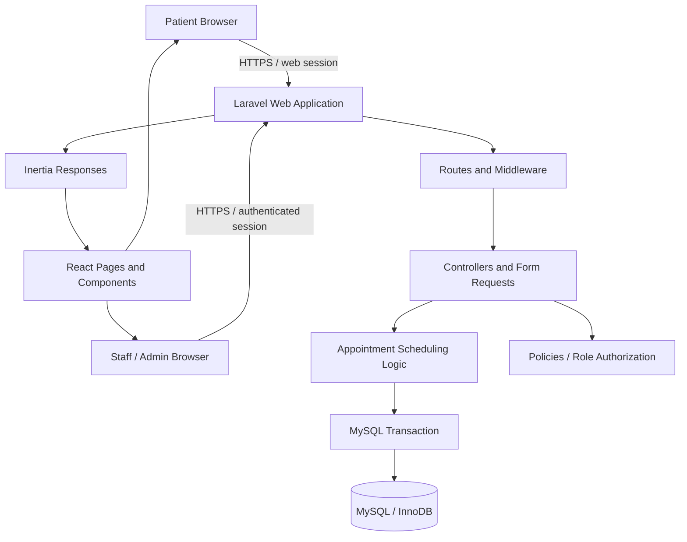
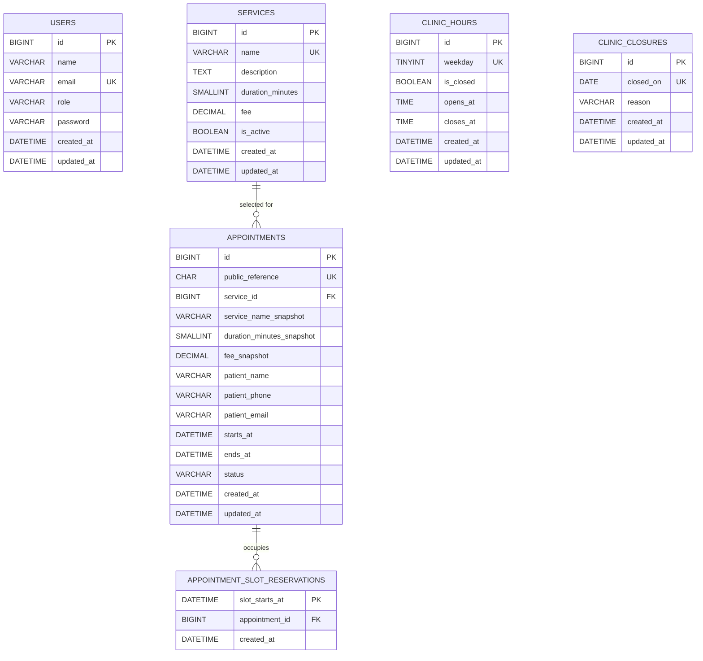

# Clinic Booking Management System — Codex Execution Specification

> **Purpose:** This file is the product brief, system-design reference, database contract, UI/UX guide, and execution contract for Codex. Inspect the repository, implement the smallest complete working system defined here, verify it, fix defects, and report evidence. Do not return only a plan.
>
> **Priority order:** Data integrity and privacy → working end-to-end flows → usability/accessibility → maintainability → visual polish. Follow **KISS (Keep It Simple)**. Do not add functionality because it is technically possible.

## 1. Mission, scope, and fixed assumptions

Build a responsive appointment-booking and management website for **one clinic with one shared appointment schedule and capacity for one appointment at a time**. Patients request appointments without creating accounts. Authenticated clinic staff manage appointments; admins also manage services, opening hours, and closure dates.

Unless the actual repository contains an explicit, conflicting requirement, use these decisions:

- **Backend:** Laravel 13, PHP 8.3 or newer.
- **Frontend:** React with Laravel's official React starter kit and Inertia. Follow the versions already installed or documented for the matching starter kit; the current official starter kit uses React 19, TypeScript, Tailwind CSS 4, Inertia 3, and shadcn/ui. Verify versions rather than guessing.
- **Database:** MySQL. If the local environment uses MariaDB through XAMPP, identify its actual version and verify migration/constraint behavior against it. Do not claim MySQL-specific integrity checks passed based only on SQLite tests.
- **Deployment shape:** One Laravel application/repository. Do not build a second React application, separate API server, microservices, or distributed system.
- **Timezone:** `Asia/Manila`. This MVP serves one clinic in one timezone. Store appointment wall-clock values in MySQL `DATETIME` fields interpreted as clinic-local time; do not append `Z` or silently convert these values to UTC. Use explicit server-side formatting for browser props and `now('Asia/Manila')` for scheduling decisions. If the repository already has a different, consistent timezone strategy, inspect it before changing it and document the chosen canonical representation.
- **Capacity model:** One appointment may occupy a given 15-minute interval. No doctor, room, branch, chair, or equipment calendars in this MVP.
- **Appointment lengths:** Service durations are positive multiples of 15 minutes. Opening and closing times must also align to 15-minute boundaries. Appointments cannot cross closing time or midnight.
- **Patient information:** Full name, phone number, and optional email only. Do not collect symptoms, diagnoses, medical history, prescriptions, or uploaded medical records.
- **Initial status:** `pending`. Staff must confirm an appointment.
- **Excluded:** Payment processing, online patient accounts, SMS/email delivery, chatbot, analytics platform, medical records, recurring appointments, external calendar sync, and public appointment lookup/cancellation by reference code.
- **Setup safety:** Do not invent a real clinic's name, address, contact details, prices, or opening hours. Use clearly labeled configurable placeholders until an admin configures the real details. Seed all seven weekdays as closed rather than inventing opening hours.

When a decision is not specified, choose the simplest safe option, record the assumption, and continue. Ask the user only if a material requirement cannot be resolved from the repository or this specification.

## 2. Required execution workflow and super-subagent orchestration

### 2.1 Inspect first; do not overwrite the project

1. Read repository instructions (`AGENTS.md` and nested instructions) and inspect Git status before edits.
2. Inspect the repository structure, `composer.json`, `package.json`, lock files, Laravel version, route definitions, authentication setup, React/Inertia entry points, existing models, migrations, tests, `.env.example`, and README.
3. Identify whether this is an existing application or a fresh project. Reuse working code and conventions. Do not recreate the app, delete files, or replace useful implementation just to match a preferred template.
4. Inspect the active database driver/server version if available. Verify whether the environment is MySQL or MariaDB, the schema/table state, engine behavior, foreign keys, unique indexes, and `CHECK` constraint enforcement. Do not print or expose secrets from `.env`.
5. Read this specification completely. Convert it into an implementation checklist and reconcile findings before code changes.

### 2.2 Preflight agents — read-only and parallel

Use real Codex subagents/super-subagents if the active Codex session actually exposes them. Start these independent reviews **in parallel**, with a target of five preflight agents and no more than five active agents at once:

| Agent | Bounded task | Required output |
|---|---|---|
| **System Design & Data Architect** | Review the scope, ERD, table dictionary, relationships, schema constraints, and migration order. | Conflicts, missing constraints, and one recommended consistent data model. |
| **Laravel/MySQL Integrity Agent** | Review Laravel 13 compatibility, transaction boundaries, 15-minute reservations, unique-key collision handling, foreign keys, indexes, and MySQL/MariaDB differences. | Concrete race conditions, migration risks, and testable fixes. |
| **UI/UX Designer Agent** | Review public booking and staff/admin flows, responsive design, labels, contrast, typography, and feedback states. | A small screen/layout plan and specific accessibility/usability checks. |
| **Security & Privacy Reviewer** | Review public registration, staff authorization, personal data exposure, validation, rate limiting, logs, and session/auth defaults. | Threats and required server-side protections. |
| **QA/Test Planner Agent** | Convert the business rules and acceptance criteria into test cases, including concurrency and invalid state transitions. | Prioritized test matrix with expected outcomes. |

The preflight agents must be **read-only**. Give each agent the relevant sections and ask it for findings, not a separate competing implementation proposal. The coordinator reconciles conflicting findings into one design before implementation starts.

### 2.3 Implementation agents — parallel only after contracts are agreed

When real subagent delegation is supported, run the following bounded workstreams in parallel after the data model, route contract, and component boundaries are agreed:

- **Backend / Database Agent:** owns `app/**`, `routes/**`, and `database/**`. Implements migrations, models, authorization, booking/scheduling logic, and controllers.
- **Frontend / UI/UX Agent:** owns `resources/js/**` and `resources/css/**` (or the existing frontend equivalents). Implements approved pages, forms, responsive states, and accessible interactions.
- **QA Agent:** owns `tests/**` and test documentation. Writes tests against the agreed route/schema contracts; it must not weaken assertions to hide failures.
- **Security / Independent Reviewer:** read-only review of the integrated application and authorization/data-handling paths.
- **Lead / Coordinator Agent:** owns shared files not assigned above, confirms contracts, resolves conflicts, integrates changes, runs final verification, and decides acceptance.

Rules for concurrency:

- Never allow two agents to write the same files at once. Use isolated worktrees/branches if supported; otherwise enforce the ownership table.
- Define route names, request/response fields, model relationships, and schema contracts before parallel implementation.
- Do not parallelize tasks that depend on unresolved decisions. Keep concurrency bounded; more agents are not automatically better.
- Reviewer agents report defects and evidence; they do not silently rewrite code owned by another agent.
- If the session lacks real subagent controls, do not simulate a spawn or claim concurrency. Perform the same reviews sequentially and report the limitation truthfully.

## 3. Minimum viable features

### 3.1 Public website and booking

- Landing page with configurable clinic name/contact placeholders, a short introduction, active service list, opening hours, and prominent **Book an Appointment** action.
- Booking flow fields, in this order where practical: service, date, available start time, patient full name, phone, optional email, privacy notice/acknowledgement if required by the implemented form design.
- Available start times come from the **server**. Changing service or date clears any previously selected time and reloads availability.
- Only valid future slots are offered. Availability must account for service duration, weekly hours, full-day closures, active slot reservations, and current time.
- On success, show a clear confirmation and one non-sequential booking reference for the patient's own records. Do not provide a public reference-lookup endpoint that reveals the appointment or patient details.
- Show clear empty, loading, validation-error, and server-error states. If a slot is taken between selection and submission, retain safe form values, clear the selected slot as needed, and ask the patient to choose another time.
- Public users must never browse other appointments or access the staff/admin area.

### 3.2 Authenticated staff/admin area

- Secure login using the installed Laravel authentication starter kit. No public staff registration.
- **Dashboard:** counts for today's appointments, pending requests, and confirmed appointments, derived from the database using `Asia/Manila` day boundaries.
- **Appointments:** paginated list, filterable by date and status, with booking reference, patient name/contact, service snapshot, start/end, and status. Only authenticated staff can see patient details.
- **Status updates:** only valid transitions; return clear success/errors. Use a confirmation step for consequential transitions if appropriate.
- **Services (admin only):** create/edit, activate/deactivate; name, optional description, duration in minutes, optional fee, active flag. Duration must be a multiple of 15 minutes. Never hard-delete a service referenced by appointments; deactivate it.
- **Clinic hours (admin only):** one editable row for each weekday; closed/open state and opening/closing times.
- **Closure dates (admin only):** full-day closure with unique date and optional short reason. A closure overrides weekly hours. Do not silently invalidate existing active appointments when adding a closure.
- **User roles:** `admin` and `staff`. Both can manage appointments. Only admins can manage service/clinic configuration. No public role selection or registration.
- No patient-account portal, medical records, staff scheduling, billing, payments, or multi-clinic configuration.

## 4. System design and architecture

### 4.1 Architecture decision

Use a **single Laravel application with React + Inertia and MySQL**. Laravel owns routing, sessions/authentication, authorization, server-side validation, business rules, database transactions, and rendering/prop delivery. React owns interactive presentation and client-side usability. MySQL is the source of truth for persisted business data and the final guard against a duplicate slot reservation.

Do not create a separate REST API server. A small same-application JSON availability endpoint is acceptable for refreshing the available times; it is not a second backend. Reuse the installed Inertia starter kit and UI components.

### 4.2 Component architecture



**Responsibilities**

- **Routes/middleware:** public booking routes; authenticated staff routes; admin-only configuration routes; rate limits for public booking.
- **Controllers:** thin HTTP coordination and response handling. Do not embed duplicate scheduling algorithms in controllers.
- **Form Requests / validation:** validate incoming fields and authorize staff actions. Never accept client-supplied status, duration snapshot, end time, fee snapshot, role, or slot-reservation rows.
- **Scheduling logic:** one focused `AppointmentSchedulingService` or equivalent, responsible for generating available slots, validating a requested time, creating the appointment and its reservations atomically, and applying status/reservation changes. Do not create a generic service/repository layer for every model.
- **Eloquent models:** explicit relationships, casts, guarded/fillable fields, and scopes only where useful. Use database foreign keys and indexes in addition to Eloquent validation.
- **React/Inertia:** display the data and errors returned by the server, refresh available slots, and prevent accidental repeated submissions. Client state is never authoritative for availability or authorization.
- **MySQL/InnoDB:** stores domain data; unique `slot_starts_at` key in the reservation table prevents two transactions from reserving the same time quantum.

### 4.3 Booking sequence and transaction boundary

```mermaid
sequenceDiagram
    actor Patient
    participant UI as React / Inertia UI
    participant App as Laravel
    participant Sched as Scheduling Service
    participant DB as MySQL / InnoDB

    Patient->>UI: Choose service, date, time, enter contact details
    UI->>App: Request available slots
    App->>Sched: Calculate slots for requested service/date
    Sched->>DB: Read hours, closures, service, reservation keys
    DB-->>Sched: Current scheduling data
    Sched-->>UI: Available start times only
    Patient->>UI: Submit booking
    UI->>App: POST appointment request
    App->>App: Validate fields and rate limit
    App->>Sched: Book selected slot
    Sched->>DB: BEGIN TRANSACTION; lock weekday row; re-check all rules
    Sched->>DB: Insert appointment + every 15-minute reservation row
    DB-->>Sched: Commit, or reject duplicate slot key
    Sched-->>App: Saved booking, or slot conflict
    App-->>UI: Confirmation + reference, or actionable validation error
```

The availability preview is advisory. The booking transaction is authoritative. An appointment and **all** of its reservation rows must commit or roll back together.

### 4.4 Route and data contract

Adapt exact names to existing conventions, but preserve these behaviors:

| Route / action | Access | Contract |
|---|---|---|
| `GET /` | Public | Landing page with active services and configured hours. |
| `GET /book` | Public | Booking form; active services only. |
| `GET /booking/availability?service_id={id}&date=YYYY-MM-DD` | Public, rate-limited reasonably | Returns available start times for the selected service/date. No patient/appointment details. |
| `POST /appointments` | Public, rate-limited | Accepts service ID, local appointment date/start time, patient name, phone, optional email. Server computes end time, snapshots, status, and reservations. |
| `GET /login` and session auth routes | Public/auth system | Use installed Laravel auth flow. Disable public account registration. |
| `GET /admin` | Authenticated staff | Dashboard counts. |
| `GET /admin/appointments` | Authenticated staff | Paginated/filterable private appointment list. |
| `PATCH /admin/appointments/{appointment}/status` | Authenticated staff | Accepts only requested new status; server validates transition and timing. |
| Service CRUD/deactivation routes | Admin only | Manage service configuration. No hard deletion of referenced services. |
| Clinic hours update route | Admin only | Updates one weekday row after integrity checks. |
| Closure-date CRUD routes | Admin only | Adds/removes closure dates after integrity checks. |

Use Laravel web/session/CSRF protections. Do not create endpoints that allow public users to read an appointment by integer ID or to enumerate references. Only return the new booking reference in the immediate successful booking response/session flash.

## 5. Business rules and lifecycle

### 5.1 Appointment status transitions

Store these exact status values: `pending`, `confirmed`, `cancelled`, `completed`, `no_show`.

| Current status | Allowed next status | Additional rule |
|---|---|---|
| `pending` | `confirmed`, `cancelled` | Server checks the transition. |
| `confirmed` | `cancelled`, `completed`, `no_show` | `completed` and `no_show` are only allowed once `ends_at` is not later than the current clinic-local time. |
| `cancelled` | None | Terminal. |
| `completed` | None | Terminal. |
| `no_show` | None | Terminal. |

Do not accept status from the public booking form. Invalid transitions return a clear validation/conflict response. Whenever a status transitions from `pending`/`confirmed` to a terminal status, delete that appointment's slot-reservation rows **in the same transaction**. Terminal appointments remain in `appointments` as history.

### 5.2 Schedule and interval rules

1. Public bookings start as `pending`.
2. Only `pending` and `confirmed` appointments consume reserved slots.
3. The schedule uses a 15-minute grid. Candidate starts must be on quarter-hour boundaries; a service duration must be a positive multiple of 15 minutes.
4. Appointment end is calculated on the server as `starts_at + duration_minutes_snapshot`; ignore or reject client-supplied end time/duration/fee/status.
5. Valid start times must be in the future, on an open weekday, not on a closure date, and inside the configured opening interval. `ends_at` must be less than or equal to closing time and cannot cross midnight.
6. Intervals are half-open: `[starts_at, ends_at)`. An appointment ending at 10:00 and the next beginning at 10:00 do **not** overlap.
7. This is a single-capacity schedule across all services. The same 15-minute quantum cannot be occupied by two active appointments.
8. An appointment retains its saved `starts_at`, `ends_at`, service-name snapshot, duration snapshot, and fee snapshot if a service is later renamed, repriced, edited, or deactivated.
9. Service deactivation prevents new bookings; it does not modify or delete existing bookings.
10. Weekly hours must have exactly seven rows (ISO weekday: Monday = 1 through Sunday = 7). Closed rows have null opening/closing times. Open rows require both times, with opening before closing and both on the 15-minute grid.
11. Seed all weekdays as closed. The UI must explain that an admin must configure opening hours before bookings can be accepted.
12. A full-day closure overrides otherwise-open weekly hours.
13. Reject a new closure date if it would invalidate any `pending`/`confirmed` appointment on that date. When hours are changed, reject a change that would put any future `pending`/`confirmed` appointment outside the new opening interval or on a newly closed weekday. Explain that the admin must resolve those appointments first.
14. Re-check service active state, date/time, weekday hours, closure date, slot step, duration, closing time, and conflicts when the booking is submitted. Never trust a prior browser availability response.
15. Public booking must be rate-limited. Do not log patient contact fields, expose them in URLs, or return other appointments' private details.

## 6. Database design contract

The schema below is the required logical design. Inspect existing migrations and reuse equivalent tables if they already exist; do not create duplicates. Use Laravel migrations as the schema source of truth. Do not ask the user to manually paste SQL when migrations can safely implement the schema.

### 6.1 ERD



`USERS`, `CLINIC_HOURS`, and `CLINIC_CLOSURES` are intentionally independent tables in this MVP. Do not add a `patients` table: this release has no patient accounts or patient profile management, and contact information is stored as a booking snapshot. Do not merge patient records based only on a shared phone/email, since family members may share contact details.

### 6.2 Required domain tables and column definitions

Types below are logical MySQL types; use equivalent Laravel migration types that produce the intended schema on the actual MySQL/MariaDB version. `BIGINT UNSIGNED` is appropriate for Laravel's normal auto-incrementing IDs. Use InnoDB/transactional tables.

#### A. `users` — Laravel authentication plus role

Reuse Laravel's existing `users` table from the starter kit. Add a role column through a safe migration if absent; do not create a second users table.

| Column | Type / nullability | Rule |
|---|---|---|
| `id` | BIGINT UNSIGNED PK | Auto-increment. |
| `name` | VARCHAR(255) NOT NULL | Staff display name. |
| `email` | VARCHAR(255) NOT NULL UNIQUE | Login email. |
| `email_verified_at` | DATETIME NULL | Preserve starter-kit convention. |
| `password` | VARCHAR(255) NOT NULL | Laravel hash only; never plaintext. |
| `role` | ENUM(`admin`, `staff`) NOT NULL DEFAULT `staff` | Never accepted from public requests. |
| `remember_token` | VARCHAR(100) NULL | Preserve starter-kit convention. |
| `created_at`, `updated_at` | DATETIME NULL | Laravel timestamps. |

Disable public registration. Provide a safe console-only account creation/bootstrap command if the existing project lacks a documented first-admin path. Prompt securely for credentials; do not hard-code a username/password or include credentials in the repository. Admin and staff roles are set by a trusted console/admin process, never by browser input.

#### B. `services`

| Column | Type / nullability | Rule |
|---|---|---|
| `id` | BIGINT UNSIGNED PK | Auto-increment. |
| `name` | VARCHAR(120) NOT NULL UNIQUE | Trim and validate; avoid duplicate names. |
| `description` | TEXT NULL | Optional plain text. Escape on display. |
| `duration_minutes` | SMALLINT UNSIGNED NOT NULL | Must be at least 15 and divisible by 15. |
| `fee` | DECIMAL(10,2) NULL | Optional; must be non-negative. This is display information only, not payment collection. |
| `is_active` | BOOLEAN NOT NULL DEFAULT TRUE | Only active services appear in public booking. |
| `created_at`, `updated_at` | DATETIME NULL | Laravel timestamps. |

Integrity: referenced services cannot be hard-deleted; use a restrictive foreign key and deactivate instead. If the service's name, duration, or fee changes, existing appointment snapshots remain unchanged.

#### C. `clinic_hours`

Exactly one row for each ISO weekday: Monday = 1, Tuesday = 2, …, Sunday = 7.

| Column | Type / nullability | Rule |
|---|---|---|
| `id` | BIGINT UNSIGNED PK | Auto-increment. |
| `weekday` | TINYINT UNSIGNED NOT NULL UNIQUE | Values 1–7, no duplicate weekday rows. |
| `is_closed` | BOOLEAN NOT NULL DEFAULT TRUE | Seed true for every weekday. |
| `opens_at` | TIME NULL | Required only when open. |
| `closes_at` | TIME NULL | Required only when open. |
| `created_at`, `updated_at` | DATETIME NULL | Laravel timestamps. |

Integrity: an open row requires `opens_at < closes_at`; both times must align to 15 minutes. A closed row has null open/close values. Add database `CHECK` constraints where the installed server enforces them; always repeat the rules in server validation and tests. Do not assume an unsupported `CHECK` was enforced.

#### D. `clinic_closures`

| Column | Type / nullability | Rule |
|---|---|---|
| `id` | BIGINT UNSIGNED PK | Auto-increment. |
| `closed_on` | DATE NOT NULL UNIQUE | One full-day closure per date. |
| `reason` | VARCHAR(160) NULL | Optional short reason; no patient data. |
| `created_at`, `updated_at` | DATETIME NULL | Laravel timestamps. |

Integrity: adding a closure must fail with a clear validation message if the date already contains any `pending`/`confirmed` appointment. Do not silently cancel, move, or delete bookings.

#### E. `appointments`

| Column | Type / nullability | Rule |
|---|---|---|
| `id` | BIGINT UNSIGNED PK | Internal identifier; never a public lookup credential. |
| `public_reference` | CHAR(26) NOT NULL UNIQUE | Generate a new ULID on the server. A unique index is mandatory. If a collision occurs, retry safely a small bounded number of times; never reveal patient data through reference lookup. |
| `service_id` | BIGINT UNSIGNED NOT NULL FK → `services.id` | Restrict service deletion. |
| `service_name_snapshot` | VARCHAR(120) NOT NULL | Copy server-trusted service name when booking. |
| `duration_minutes_snapshot` | SMALLINT UNSIGNED NOT NULL | Copy current server-trusted duration. Must be positive and divisible by 15. |
| `fee_snapshot` | DECIMAL(10,2) NULL | Copy current fee when booking; null stays null. No payment processing. |
| `patient_name` | VARCHAR(150) NOT NULL | Trimmed, validated name. |
| `patient_phone` | VARCHAR(32) NOT NULL | Preserve valid local/international characters; do not impose a US-only phone format. |
| `patient_email` | VARCHAR(254) NULL | Optional valid email. |
| `starts_at` | DATETIME NOT NULL | Clinic-local date/time, server-validated on 15-minute boundary. |
| `ends_at` | DATETIME NOT NULL | Computed server-side; must be after start and within configured hours. |
| `status` | ENUM(`pending`, `confirmed`, `cancelled`, `completed`, `no_show`) NOT NULL DEFAULT `pending` | Server-controlled allowed transitions. |
| `created_at`, `updated_at` | DATETIME NULL | Laravel timestamps. |

Required indexes: unique `public_reference`; foreign-key index on `service_id`; index on `starts_at`; composite index on (`status`, `starts_at`) for filtered staff lists/counts. Add only other indexes justified by actual queries.

Snapshots are intentional. `service_id` preserves the relational link, while snapshots preserve what was booked even if a service is later edited. No route in this MVP hard-deletes appointments; retain terminal appointments as history.

#### F. `appointment_slot_reservations` — database-level double-booking guard

This table records the 15-minute quanta currently consumed by `pending` or `confirmed` appointments. It is an active occupancy ledger, not appointment history.

| Column | Type / nullability | Rule |
|---|---|---|
| `slot_starts_at` | DATETIME NOT NULL PRIMARY KEY | Unique across the entire single-clinic schedule. A value represents one 15-minute interval beginning at that clinic-local time. |
| `appointment_id` | BIGINT UNSIGNED NOT NULL FK → `appointments.id` | Index this column; one appointment has many reservation rows. |
| `created_at` | DATETIME NULL | Optional timestamp for inspection/debugging, not patient data. |

For an appointment `[09:00, 09:30)`, create reservations at `09:00` and `09:15`; do not reserve `09:30`. The primary key on `slot_starts_at` means that two appointments cannot reserve the same interval, even if two requests race. Because starts and durations are constrained to the 15-minute grid, any overlapping appointments necessarily attempt to insert at least one identical reservation key.

**Invariant:** an appointment with status `pending` or `confirmed` owns exactly one reservation row per 15-minute quantum in `[starts_at, ends_at)`. An appointment with status `cancelled`, `completed`, or `no_show` owns no reservation rows. The appointment insert/update and all affected reservation inserts/deletes happen inside the same database transaction. Never use `INSERT IGNORE`, silent upsert, or a check-then-insert as the only double-booking control.

If an existing database already contains appointments, inspect its data before introducing this table. Backfill reservation rows only after checking active appointments for overlapping intervals. If conflicts exist, stop and report the conflicting rows; do not arbitrarily cancel, delete, or rewrite historical appointments to make migration pass.

### 6.3 Laravel operational tables

Preserve the tables used by the installed starter kit/configuration (for example `password_reset_tokens`, `sessions`, `cache`, `cache_locks`, `jobs`, `job_batches`, or `failed_jobs` only if existing migrations/drivers require them). These are framework/infrastructure tables, not extra clinic-domain entities. Do not add queues, cache tables, or other infrastructure merely because they are available.

### 6.4 Relationships and delete behavior

- `services` **1 → many** `appointments`.
- `appointments` **1 → many** `appointment_slot_reservations`.
- `users`, `clinic_hours`, and `clinic_closures` have no additional domain relationship in this MVP.
- `appointments.service_id` references `services.id` with delete restriction. Do not cascade-delete appointment history when a service is deleted.
- `appointment_slot_reservations.appointment_id` references `appointments.id`; choose a safe restrictive or cascading action consistent with the migration, but the application must not provide appointment-delete functionality. Never rely on cascades as a substitute for the scheduling service's transaction logic.
- Add primary keys, foreign keys, `NOT NULL`, unique constraints, and indexes through migrations. Use database-level `CHECK` constraints for simple row rules where the active MySQL/MariaDB version supports enforcement. Always validate at the application boundary too.

### 6.5 Migration and seeding order

Recommended logical order, adapted to existing migrations:

1. Existing Laravel `users` migration and a forward-only role migration if needed.
2. `services`.
3. `clinic_hours`.
4. `clinic_closures`.
5. `appointments` with foreign key to `services`.
6. `appointment_slot_reservations` with foreign key to `appointments`.
7. Safe demo/setup seeders, if required.

Seed exactly seven `clinic_hours` rows, all closed by default. Do not seed a real admin password. Do not seed real patient data. Demo services may be seeded only as clearly fictional examples and must not be presented as the real clinic's confirmed offerings. Make seeders idempotent where reasonable.

## 7. Transaction design and integrity implementation

### 7.1 Create booking algorithm — mandatory order

Implement the following in one focused scheduling service/action; keep the controller thin:

1. Validate request shape (`service_id`, `date`, `start_time`, `patient_name`, `patient_phone`, optional `patient_email`). Reject malformed dates/times and unexpected client-controlled fields as appropriate.
2. Parse appointment date/time strictly in `Asia/Manila`. Do not trust a posted `ends_at`, service duration, fee, appointment status, role, or reservation list.
3. Start a MySQL/InnoDB transaction.
4. Lock the `clinic_hours` row for the selected ISO weekday using `lockForUpdate()`. This serializes a booking with admin edits to the same weekday's hours/closure configuration. The seven rows must exist; if the selected row is missing, fail closed with a setup error, not an open schedule.
5. Load and lock the selected service row, then verify it exists and is active.
6. Check the full-day closure, opening status, future start time, slot-grid alignment, duration, and end-before-closing rule.
7. Calculate `ends_at` and all 15-minute reservation timestamps on the server. Check the existing reservation ledger to provide a useful early conflict message; this read is **not** the final integrity guard.
8. Create the appointment using server-trusted snapshots and status `pending`.
9. Insert one `appointment_slot_reservations` row for each slot start in `[starts_at, ends_at)`. Use ordinary inserts so duplicate primary-key conflicts are not hidden.
10. Commit only when the appointment and all reservations succeed. If any reservation key collides, roll back the entire transaction so no orphan appointment remains, then return a friendly “That time was just booked; choose another time” response. Catch and translate only the expected duplicate-key conflict; rethrow or report unrelated database errors rather than disguising them as availability conflicts.
11. Return the booking reference once via the success response/session flash. Do not expose the new appointment by public integer ID.

All code paths that create bookings must use this operation. Do not add a second staff-booking path that bypasses it.

### 7.2 Status changes

- Authenticate the user and enforce staff authorization on the server.
- Lock the appointment row and its weekday schedule row inside a transaction before changing status/reservations.
- Verify the current status and allowed transition. Do not accept arbitrary status assignment.
- Do not allow `completed` or `no_show` before `ends_at` has passed in clinic-local time.
- When transitioning to `cancelled`, `completed`, or `no_show`, remove all reservation rows for that appointment in the same transaction as the status update.
- When transitioning `pending` to `confirmed`, retain the reservation rows; do not create duplicates.
- If any step fails, roll back the status and reservation changes together.

### 7.3 Schedule configuration updates

- When changing one weekday's hours, lock its `clinic_hours` row, validate the new times, then inspect `pending`/`confirmed` appointments with `ends_at` later than the current clinic-local time on that weekday (including appointments already in progress). Reject the update if any appointment would fall outside the new window or on a newly closed day. The UI must tell the admin to resolve affected appointments first.
- When adding a `clinic_closures` date, lock that date's weekday row, verify the date has no `pending`/`confirmed` appointments/reservations, and then add the closure in the same transaction.
- When removing a closure, lock the matching weekday row and delete only the selected closure.
- Keep all booking, status, and calendar-configuration transactions consistent about lock order to reduce deadlocks. On deadlock, use a small bounded transaction retry if supported by the installed Laravel version.
- If the final MySQL unique key detects a conflict despite application checks, treat it as an expected concurrency conflict and roll back cleanly.

### 7.4 Database integrity essentials

- Actual foreign keys and unique indexes are required; Eloquent relationships alone do not enforce integrity.
- Use a unique index on `services.name`, `clinic_hours.weekday`, `clinic_closures.closed_on`, `appointments.public_reference`, and `appointment_slot_reservations.slot_starts_at`.
- Add the appropriate foreign keys and delete behavior described above.
- Keep `appointments.service_id` and historical service snapshots consistent at booking creation.
- Never allow React-controlled `is_admin`, `role`, price/fee, duration, end time, status, or reference code to override server values.
- Use safe mass-assignment configuration and validated fields only.
- Test that a failed insert/transaction leaves neither an appointment nor a partial set of reservations.

## 8. UI/UX design requirements

### 8.1 Visual direction

Create a **calm, modern, trustworthy clinic interface**. It should look polished and easy to understand, not like a complex hospital enterprise system.

- Use a light neutral background, white content surfaces, dark navy/charcoal text, and one restrained blue or blue-teal accent. Use muted borders and subtle shadows only where they help grouping.
- Reuse the official starter kit's Tailwind and shadcn/ui components when present. Do not add another UI framework or a theme package just to style a few pages.
- Use a readable sans-serif font already available in the project or a system font stack. Body copy should normally be at least 16px. Do not shrink labels, table text, helper text, and status chips to fit a layout.
- Establish consistent spacing, consistent button height, alignment, border radius, form width, and heading hierarchy. Prioritize information hierarchy over decoration.
- Avoid excessive gradients, parallax, distracting animations, oversized blank hero areas, cluttered dashboards, and unnecessary charts.

### 8.2 Public landing page

- Simple header with clinic name/logo placeholder, navigation to Services/Hours, and a clear booking action.
- Hero section: concise value statement, short supporting copy, primary **Book an Appointment** button, and optional secondary Services action.
- Show active services as simple cards/list rows with service name, short description, duration, and fee only when configured.
- Show configured opening hours and a concise “How booking works” section (choose service/time → enter contact details → wait for clinic confirmation).
- Keep all real clinic identity/contact information configurable; do not invent an address or claim notification delivery that is not implemented.
- Footer includes a brief privacy statement/contact placeholder.

### 8.3 Booking form

- Present a short, clearly ordered form: **Service → Date → Available time → Your details → Submit**. A single page is preferred; avoid building a complex multi-page wizard.
- Use native date/time controls or simple accessible buttons for server-provided time slots. Make unavailable/loading slots obvious without relying on color alone.
- When service/date changes, clear the previous slot selection and fetch fresh availability. Disable duplicate submission while saving.
- Every field needs a persistent visible label, suitable autocomplete attributes, concise helper text where needed, and field-specific error association.
- Use a friendly empty state (“No available times on this date. Try another date or service.”), loading state, success state, and retryable server-error state.
- Do not expose patient names, email, phone, or any existing appointment information in availability JSON or page props.
- After successful submission, show the unique booking reference and clarify that the appointment is **pending clinic confirmation**. Do not imply that it is confirmed.

### 8.4 Staff/admin experience

- Use a clean application shell with a compact sidebar on desktop and a simple accessible navigation pattern on mobile.
- Dashboard contains only useful counts and a compact list of upcoming/pending appointments; do not add ornamental charts.
- Appointment list needs a clear page title, search/filter controls (date/status), readable columns, clear status labels, pagination, and an obvious path to view/change a booking status.
- At narrow widths, use a horizontally scrollable table or responsive cards; never clip patient details or hide the only available action.
- Service/hours/closure forms should have short labels, explanatory validation, save/cancel actions, and explicit feedback.
- Distinguish normal actions from destructive/consequential actions. Confirm only actions with meaningful consequences; do not prompt for every routine click.

### 8.5 Accessibility and interaction

- Target WCAG 2.2 AA for the implemented controls and layouts where feasible.
- Text contrast: at least 4.5:1 for normal text and 3:1 for large text. Never communicate appointment status by color alone; include visible text.
- Body text generally >=16px; target touch controls around 44px high; buttons must have clear verb-led labels and visible hover/focus states.
- Support keyboard navigation, visible focus, logical focus order, semantic headings, correct input types, meaningful link names, and screen-reader-readable validation messages.
- Icon-only controls require accessible names and tooltips where helpful; prefer text labels for critical actions.
- Show field validation, request progress, success, error, empty, and disabled states. Do not leave dead buttons, fake loading indicators, unimplemented menus, or placeholder links presented as working.
- Respect reduced-motion preferences and avoid using animation as the only feedback.

## 9. Security and privacy

- Use Laravel's existing authentication, session, CSRF protection, hashing, validation, and authorization facilities. Do not hand-roll authentication.
- Disable public account registration. Every admin/staff management route must require authentication; configuration routes also require admin role. Authorization is checked on the server; hiding UI controls is not protection.
- Public booking routes accept only validated fields, are rate-limited, and return no other patient's data.
- Use Form Requests or an equivalent centralized validator. Verify referenced IDs exist and are allowed. Do not use unvalidated request arrays for mass assignment.
- Store patient name/contact only for appointment management. No medical details, unnecessary analytics, or patient data in logs, URLs, exception messages, or client-side global props.
- Escape service descriptions and all user-supplied text. Use Laravel's standard output escaping; do not render user input as raw HTML.
- Never commit `.env`, passwords, access tokens, production database contents, or real patient records. Update `.env.example` with safe placeholders only.
- Provide an appropriate short privacy notice. Do not claim legal compliance. The clinic must confirm its own privacy notice, retention policy, lawful basis, and obligations under applicable law, including Philippine privacy law where relevant.
- Do not claim “fully secure,” “production-ready,” or “fully compliant” only because tests pass. Report deployment/security tasks not verified.

## 10. Testing and acceptance criteria

Use installed Laravel/Pest/PHPUnit and frontend scripts; do not add a second testing framework without a concrete need. Test business behavior through routes/controllers and real persistence wherever possible.

### 10.1 Schema and migrations

- Migrations run from an empty, disposable test database in the correct order.
- Existing migrations are reviewed before changes; there are no duplicate domain tables or duplicate role columns.
- Seven weekday rows exist exactly once after seeding; all initially closed.
- Unique constraints work for service name, weekday, closure date, booking reference, and slot start.
- Foreign keys reject invalid service/appointment references and referenced services cannot be hard-deleted.
- Database constraints are verified on the actual MySQL/MariaDB version where available. A passing SQLite run alone is not proof of MySQL locking/index/constraint behavior.
- If the project already contains appointments, migration/backfill preserves them and reports conflicts without deleting/re-writing data.

### 10.2 Booking and availability

- Public pages render; only active services are shown.
- A valid booking creates exactly one `pending` appointment, correct server-computed end/snapshots, a unique reference, and exactly the right reservation rows.
- Required fields and optional email validate correctly.
- Invalid/nonexistent/inactive services, malformed/past dates, invalid time, non-quarter-hour start, closed weekday, closure date, outside-hours start, end after closing, and service duration not divisible by 15 are rejected.
- A 30-minute appointment reserves exactly two 15-minute slots; a 45-minute appointment reserves exactly three; end boundaries are exclusive.
- Adjacent bookings (for example 09:00–09:30 then 09:30–10:00) are allowed; any genuine interval overlap is rejected.
- Duplicate submissions at the same slot cannot create two active appointments. Test a race using separate MySQL/MariaDB connections/processes if practical.
- If a slot primary-key collision occurs during insert, the whole transaction rolls back and leaves no partial appointment/reservation rows.
- Cancelled/completed/no-show appointments have no reservation rows; pending/confirmed appointments retain exactly the right reservation rows.
- A stale browser selection is revalidated and rejected cleanly if a different booking wins the slot.
- Public availability does not return patient/appointment details. No public route exposes private records by integer ID/reference guessing.
- Reference-code generation handles a collision safely (at least a unit test for the retry/failure path).
- Public booking is rate-limited.

### 10.3 Staff/admin permissions and configuration

- Guests cannot access staff pages/actions. Staff cannot access admin-only service/hours/closure mutations. Admins can access them.
- Public registration cannot create a staff/admin account or choose a role.
- Admin/staff can list/filter appointments and execute only allowed status transitions.
- `completed`/`no_show` is rejected before appointment end. Invalid transitions are rejected. Terminal statuses cannot be reopened.
- Status change and reservation deletion succeed/fail atomically.
- Service rename/fee/duration change/deactivation does not change existing snapshots, appointment interval, or reservation rows.
- Closure creation fails if the date contains a pending/confirmed appointment. Opening-hours changes fail if they would invalidate future active appointments.
- Dashboard counts reflect actual rows and the clinic-local day boundary.

### 10.4 UI/build/security checks

- React production build succeeds; run configured lint/type-check scripts if present.
- Form errors are visible and associated with fields; loading/success/error/no-slot states are implemented.
- Primary flows are usable on mobile and desktop, via keyboard, and with visible focus.
- Contrast and text/button size rules have been checked.
- Staff-only pages and mutation endpoints are protected even when called directly without using the UI.
- README has setup, `.env`, MySQL/MariaDB configuration, migrations/seeding, first-admin setup, run/test commands, and known assumptions.

If the environment cannot safely provide MySQL/MariaDB concurrency tests or a browser check, report `BLOCKED`/`NOT RUN`, state why, and do not claim those checks passed.

## 11. Loop engineering: inspect → implement → test → review → repair

Do not stop after files compile once.

1. **Preflight:** run read-only agent reviews; reconcile scope/schema/security/test plan.
2. **Implement a vertical slice:** build public service/time selection through a real database booking and success response before adding dashboard polish.
3. **Run checks:** migrations/status, tests, route inspection, frontend build, lint/type check, and MySQL/MariaDB-specific tests available in the environment.
4. **Independent review:** ask Reviewer, Security, Data Integrity, and UI/Accessibility agents to read the integrated changes and identify concrete defects; no reviewer should weaken tests or rewrite another agent's owned files without coordination.
5. **Triage by impact:** repair data-loss/double-booking/privacy/authentication failures and broken core flows first, then UI issues. Ignore subjective cosmetic churn while important checks fail.
6. **Root-cause debugging:** debugging agent must explain reproduction and root cause before a focused fix; coordinator assigns file ownership.
7. **Retest:** rerun the failing test and the related suite after each repair. After changes to schema/scheduling, rerun data-integrity tests. After auth changes, rerun direct-access tests. After frontend/dependency changes, rerun the frontend build.
8. **Repeat:** perform up to three complete review-and-repair cycles or until all available checks pass. If a check remains blocked after the third cycle, report the blocker and the exact unverified behavior.

Never loosen assertions, delete tests, suppress useful errors, fabricate agent output, or label a check `PASS` without executing it.

## 12. KISS architecture boundaries

Preferred: Laravel routes/controllers/Form Requests, Eloquent models, one focused scheduling service, policies/gates or a simple established role check, migrations, Inertia pages, and feature tests.

Avoid unless the repository has a verified need:

- Separate React SPA/API server, microservices, GraphQL, event bus, WebSockets, complex repository pattern, generic service layers for every model, or elaborate domain framework.
- Redux/Zustand or a global client state layer for a few forms.
- Queues, notifications, payments, external calendar integrations, analytics, SMS/email gateways, or complex calendar libraries.
- Full audit-log platform, patient portal, patient profiles, doctor/room scheduling, multiple clinics, recurring appointments, or medical-record functionality.
- Extra packages when Laravel/React/Tailwind/starter-kit utilities already solve the problem.
- A full SQL dump as the primary schema workflow. Laravel migrations and seeders are authoritative.
- Broad unrelated refactoring or restyling of working components.

Keep controllers thin, scheduling rules centralized, database tables purpose-specific, and frontend components reusable only when repetition justifies them. Favor explicit readable code over clever abstractions.

## 13. Database and repository safety rules

- Inspect Git status before and after work. Preserve pre-existing modifications and untracked files unrelated to the task.
- Never run `migrate:fresh`, `db:wipe`, `DROP TABLE`, destructive SQL, truncate commands, or reset a database unless its identity is verified and it is explicitly a disposable development/test database.
- Do not point automated tests at a production/shared database. Use a disposable test database for migration resets and concurrency tests.
- Do not “fix” schema/migration failures by deleting data. Inspect the failure, report affected rows, and propose a safe migration/backfill plan.
- Use forward-only Laravel migrations for schema changes. Do not edit an already-deployed migration just to make local setup easy; inspect usage first.
- Never leak secrets or private patient data in logs, screenshots, reports, or committed files.
- Use labels `PASS`, `FAIL`, `BLOCKED`, and `NOT RUN` honestly for verification results.

## 14. Definition of done

The project is accepted only when all applicable points below are verified:

- Patient can select an active service and server-available time, submit contact details, and receive a truthful pending-confirmation message/reference.
- Staff/admin authentication and permissions are enforced server-side.
- Staff can view/filter appointments and update valid statuses; admins can manage services, hours, and closure dates.
- MySQL enforces the unique slot-reservation key, foreign keys, and required unique constraints; no double-booking can occur through concurrent submissions.
- Appointment snapshots remain stable after service edits.
- Schedule configuration changes cannot silently invalidate future active appointments.
- Public endpoints expose no other patient's records or private contact information.
- Relevant automated tests pass, production frontend build succeeds, and unverified platform-specific tests are reported accurately.
- UI is responsive, readable, keyboard-usable, and contains no dead/fake controls.
- README documents setup, MySQL/MariaDB configuration, first-admin creation, migrations/seeders, run/test commands, and limitations.
- Remaining gaps are called out. Never claim the system works “perfectly” or is production-ready without evidence.

## 15. Final implementation report required from Codex

At completion, return a concise report with:

1. **Implemented:** features and end-to-end flows completed.
2. **Architecture:** actual Laravel/React/Inertia/database versions found or installed.
3. **Schema:** tables/migrations, constraints/indexes, ERD deviations (if any), and migration/backfill status.
4. **Agent workflow:** actual agents used, what ran in parallel, and what could not be delegated. Do not invent subagent results.
5. **Verification:** exact commands and `PASS`/`FAIL`/`BLOCKED`/`NOT RUN` outcomes, including whether tests used SQLite, MySQL, or MariaDB.
6. **Setup:** safe commands to configure the environment, migrate/seed, create the first admin, and run the app.
7. **Known limitations:** anything not implemented/tested and any remaining production configuration work.

Do not claim a feature is complete because files were generated. It is complete only after integration and relevant verification.

## 16. Official references to verify version-specific behavior

Prefer the official documentation matching the installed versions and database server:

- Laravel 13 React starter kit: https://laravel.com/framework/docs/13.x/starter-kits
- Laravel 13 database migrations/transactions: https://laravel.com/framework/docs/13.x/database/migrations
- Laravel 13 database queries and locking: https://laravel.com/framework/docs/13.x/queries
- Laravel 13 validation: https://laravel.com/framework/docs/13.x/validation
- Laravel 13 authorization: https://laravel.com/framework/docs/13.x/authorization
- Laravel 13 deployment/server requirements: https://laravel.com/framework/docs/13.x/deployment
- MySQL 8.4 `CHECK` constraints: https://dev.mysql.com/doc/refman/8.4/en/create-table-check-constraints.html
- MySQL 8.4 unique indexes: https://dev.mysql.com/doc/refman/8.4/en/create-index.html
- OpenAI Codex multi-agent guidance: https://developers.openai.com/api/docs/guides/agents-api/multi-agent
- W3C WCAG 2.2 contrast minimum: https://www.w3.org/WAI/WCAG22/Understanding/contrast-minimum.html
- Philippine National Privacy Commission, Data Privacy Act: https://privacy.gov.ph/data-privacy-act/

---

**Start now:** inspect the repository and active database; perform the parallel read-only super-subagent reviews if real tools are available; reconcile the system design, ERD, schema and route contracts; implement the smallest complete MVP; run the review/fix/retest loop; and report only verified results.
